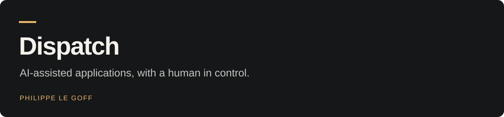
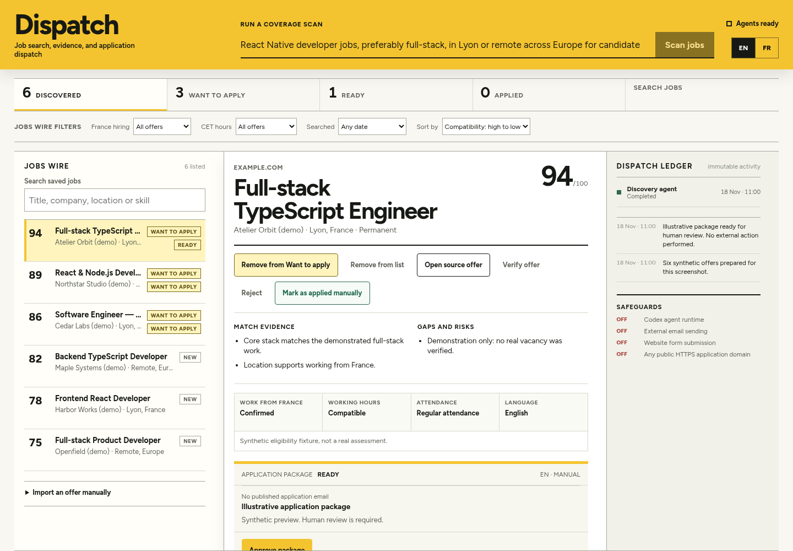
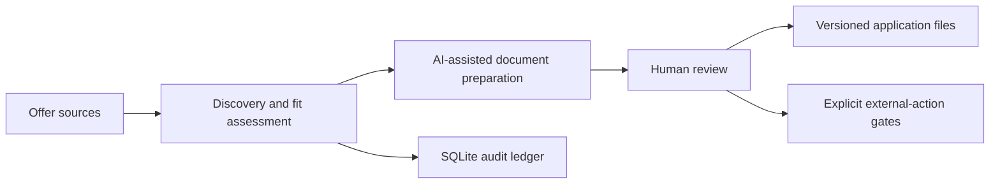

[Français](docs/CASE_STUDY.fr.md) · [Philippe Le Goff](https://github.com/PhilLeGoff) · [Portfolio](https://www.webbyphil.net/)

# Dispatch

A local-first application that helps discover relevant job offers, assess their fit, and prepare factual application documents. Discovery, generated files and decisions stay connected in an audit trail.

**Angular · TypeScript · Node.js · Express · SQLite**

*Screenshot context: real application interface rendered locally with synthetic fixtures. Displayed AI results are illustrative fixtures, not measured model output.*

## What it does

- Discover and deduplicate offers while retaining their original sources.
- Separate candidate evidence, fit reasons and eligibility uncertainties.
- Generate French or English application packages for review.
- Keep email and form submission behind explicit approval and separate environment gates.

## Architecture

## My contribution

I designed and implemented this personal application, connecting the Angular interface, TypeScript API, AI command runner and document workflow. The engineering focus is traceability: a generated statement should remain tied to candidate evidence, and preparing a document should never silently become an external action.

## Running and inspecting the project

No application source or hosted demo is distributed here. The private development setup uses Node.js and npm, with a local SQLite database. Screenshots use synthetic fixtures and trigger no AI calls, email or form submission.

## Current state and limitations

This is a personal tool, not a commercial service. AI output and offer eligibility require human verification. Website adapters depend on the target site. The source remains private; this repository contains the public case study only.

## Credits

Project and case study: Philippe Le Goff. Existing tools, libraries and their respective authors retain their own rights.
