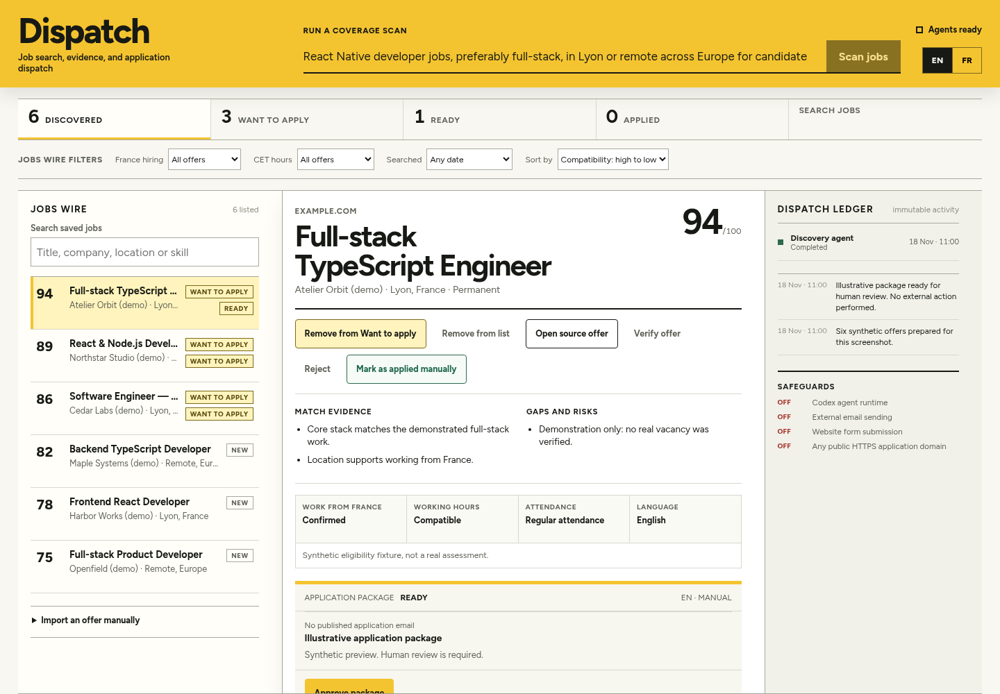
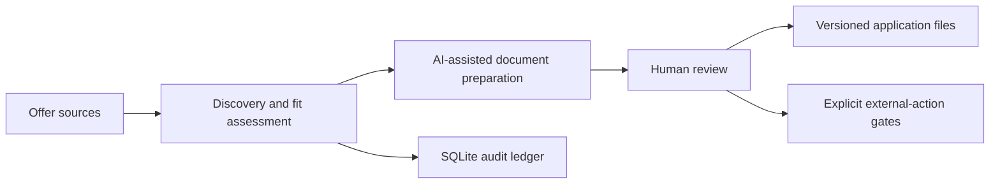

# Dispatch

**Des candidatures assistées par IA, sous contrôle humain.**

[English](../README.md) · [Portfolio](https://www.webbyphil.net/)

Une application locale pour découvrir des offres pertinentes, évaluer leur adéquation et préparer des documents de candidature factuels. Les sources, fichiers générés et décisions restent reliés dans un journal d’audit.

**Angular · TypeScript · Node.js · Express · SQLite**

*Interface réelle exécutée localement avec des données fictives. Les résultats IA affichés sont illustratifs et ne constituent pas une mesure des modèles.*

## Fonctionnalités

- Découverte et dédoublonnage des offres avec conservation des sources.
- Séparation des preuves, des raisons de correspondance et des incertitudes d’éligibilité.
- Préparation de candidatures françaises ou anglaises à relire.
- Envoi par e-mail et formulaire soumis à une approbation et à des verrous distincts.

## Architecture

## Ma contribution

J’ai conçu et développé cette application personnelle, en reliant l’interface Angular, l’API TypeScript, l’exécution de l’assistant IA et le parcours documentaire. Le fil conducteur est la traçabilité : une affirmation doit rester liée aux faits du candidat, et la préparation d’un document doit rester distincte d’une action externe.

## Installation et consultation

Ce dépôt ne distribue ni le code applicatif ni une démonstration hébergée. Le développement privé utilise Node.js, npm et SQLite. Les captures utilisent des données fictives et ne déclenchent aucun appel IA, e-mail ou envoi de formulaire.

## État actuel et limites

Il s’agit d’un outil personnel, pas d’un service commercial. Les réponses IA et l’éligibilité des offres demandent une vérification humaine. Les adaptateurs de formulaires dépendent des sites ciblés. Le code reste privé ; ce dépôt contient uniquement l’étude de cas publique.

Les crédits et références d’origine sont conservés dans le [README principal](../README.md#credits).
